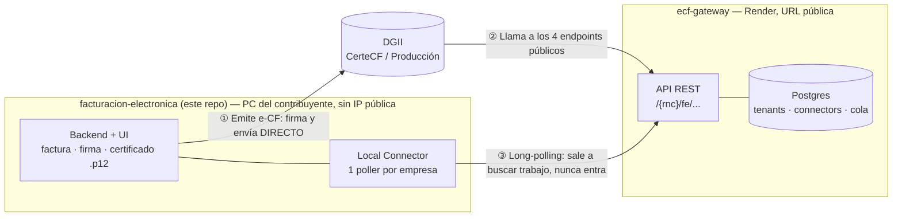
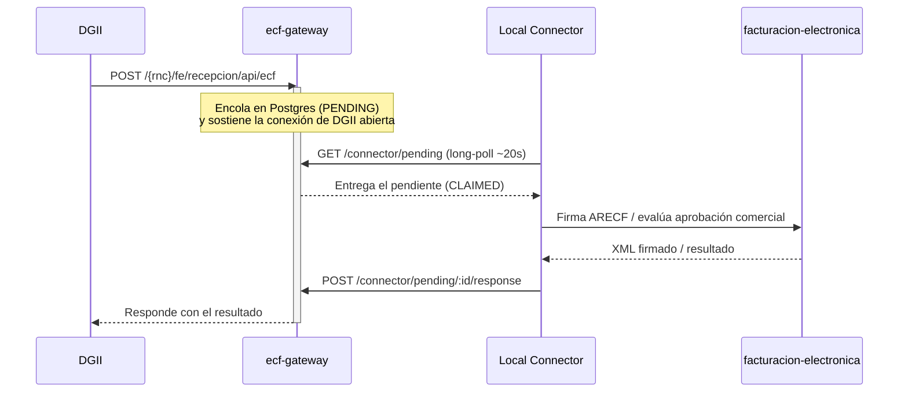

# Facturacion Electronica RD (Desktop App)

Aplicacion de escritorio para facturacion electronica en Republica Dominicana usando:

- `frontend`: React + Vite + Tailwind
- `backend`: Node.js + Prisma + SQLite
- `electron`: contenedor desktop

Este repo es la mitad **local** de un sistema de dos repos: corre en la PC del contribuyente, sin
IP pública, y es quien arma, firma y envía las facturas electrónicas (e-CF) a DGII. La otra mitad
— [`ecf-gateway`](https://github.com/lazala-jochy/ecf-gateway), desplegado con URL pública en
Render — existe únicamente porque DGII necesita poder llamarte a vos (recepción, aprobación
comercial, autenticación), y esta PC no puede recibir conexiones entrantes. Ver su README para el
detalle de ese lado.

---

## Arquitectura



Dos caminos, totalmente distintos:

- **Saliente** (lo que hace este backend al emitir una factura desde Cotizaciones/Clientes):
  firma el XML con el `.p12` de la empresa y lo envía **directo** a los servidores reales de DGII.
  No pasa por `ecf-gateway` en absoluto.
- **Entrante** (lo que DGII te manda a vos: recepción de un e-CF ajeno, aprobación comercial,
  semilla/validación de certificado): como esta PC no tiene IP pública, DGII llama en realidad a
  `ecf-gateway`, que sostiene la conexión mientras el **Local Connector** — un worker dentro de
  este mismo backend (`src/services/ecfGatewayConnector.service.ts`) — sale a buscar esa solicitud
  por long-polling, la procesa acá adentro, y le devuelve el resultado al gateway.

### Flujo entrante paso a paso (ej. recepción de un e-CF ajeno)



### Configurar el Local Connector

En **Perfil de empresa → Integración DGII** se configuran dos campos por empresa:

- **URL del gateway**: solo el dominio (ej. `https://ecf.lazalainnovaciones.com`), sin ningún path.
- **API key del connector**: se genera una sola vez desde el panel admin de `ecf-gateway`
  (`/admin` → tenant → Connectors → Crear connector) y no se puede volver a ver — si se pierde,
  se revoca y se crea uno nuevo.

Esta misma instalación puede atender **varias empresas a la vez**: cada una con su propio
connector configurado arranca su propio poller independiente. Un reescaneo cada 30s detecta altas,
bajas y cambios de API key sin reiniciar el backend. El estado de certificación/producción
(`dgii_environment`) también vive en el perfil de cada empresa — ver **Pruebas DGII** en la app.

---

## 1) Requisitos para instalar en una PC

En la PC destino necesitas:

- [Node.js 20+ LTS](https://nodejs.org/)
- `npm` (viene con Node.js)
- Windows 10/11 (para `.exe`) o macOS/Linux para desarrollo

Verifica:

```bash
node -v
npm -v
```

---

## 2) Instalacion del proyecto

Desde la raiz del proyecto:

```bash
cd backend && npm install
cd ../frontend && npm install
cd ../electron && npm install
```

---

## 3) Base de datos (Prisma + SQLite)

La base de desarrollo es **`backend/prisma/dev.db`**. Los esquemas viven en `backend/prisma/schema.prisma` y las migraciones en `backend/prisma/migrations/`.

### Aplicar migraciones (lo habitual)

Desde la carpeta **`backend`**:

**Desarrollo** (aplica migraciones pendientes; si cambiaste el schema, crea una migración nueva y la aplica):

```bash
cd backend
npx prisma migrate dev
```

Equivale a:

```bash
cd backend
npm run migrate:dev
```

**Producción o CI** (solo aplica migraciones ya versionadas, sin preguntar ni generar archivos nuevos):

```bash
cd backend
npx prisma migrate deploy
```

Equivale a:

```bash
cd backend
npm run migrate:deploy
```

### Cliente de Prisma (tras cambiar `schema.prisma`)

```bash
cd backend
npx prisma generate
```

O:

```bash
cd backend
npm run prisma:generate
```

### Primera instalación en una máquina nueva

```bash
cd backend
npm install
npx prisma migrate deploy
npx prisma generate
```

> **`migrate deploy`** no crea migraciones; úsalo cuando ya existan en el repo. Para iterar el modelo en local, usa **`migrate dev`**.

### Cotizaciones (RD / DGII)

El modelo incluye **`cotizaciones`** e **`cotizacion_items`** (ITBIS 18%). Tras cambios grandes de esquema en desarrollo se puede sincronizar con:

```bash
cd backend
npx prisma db push
```

En producción conviene generar migraciones con `migrate dev` desde un estado limpio y versionarlas en `prisma/migrations/`.

---

## 4) Ejecutar en modo desarrollo (desktop + auth + dashboard)

### Opcion rapida (un solo comando)

Desde la **raiz del proyecto** (una sola vez, para instalar el orquestador):

```bash
npm install
```

Luego, cada vez que quieras levantar todo:

```bash
npm run dev
```

Esto mata cualquier proceso que quede escuchando en los puertos `3001`/`5173`, levanta `backend` y `frontend` en paralelo, y arranca `electron` automaticamente en cuanto ambos esten listos (usa `concurrently` + `wait-on`). Con `Ctrl+C` se detienen los tres a la vez.

> Si nunca instalaste dependencias de cada modulo, corre primero `npm run install:all` desde la raiz (equivale a `npm install` en `backend`, `frontend` y `electron`).

### Opcion manual (3 terminales)

### Terminal 1: Backend

```bash
cd backend
npm run dev
```

### Terminal 2: Frontend (Vite)

```bash
cd frontend
npm run dev
```

### Terminal 3: Electron

```bash
cd electron
npm run start
```

La app de escritorio abrira y cargara el frontend en `http://localhost:5173`, consumiendo backend en `http://localhost:3001`.

---

## 5) Build de produccion por modulo

### Opcion rapida (un solo comando desde Electron)

```bash
cd electron
npm run build:modules
```

Este comando ejecuta en orden:

1. `frontend`: `npm run build`
2. `backend`: `npx tsc --noEmit`
3. `electron`: `npm run compile`

### Frontend

```bash
cd frontend
npm run build
```

Genera: `frontend/dist`

### Backend (TypeScript check)

```bash
cd backend
npx tsc --noEmit
```

### Electron

```bash
cd electron
npm run compile
```

Genera: `electron/dist`

---

## CI: generar ambos instaladores con un push a `main`

El "un comando" real para generar Windows + macOS a la vez es **hacer push a `main`** con
cambios en `backend/`, `frontend/` o `electron/`. Un workflow de GitHub Actions
(`.github/workflows/release-desktop.yml`) se encarga de todo:

1. Corre en paralelo en un runner **Windows** y uno **macOS** — no se puede compilar ambos desde
   una sola máquina: Prisma usa un motor de consultas en binario nativo específico por sistema
   operativo (el mismo que se empaqueta dentro del instalador vía `extraResources` en
   `electron/package.json`), así que cada runner instala sus propias dependencias y genera el
   binario correcto para su SO.
2. Cada uno compila (`frontend` + `backend` + `electron`) y empaqueta su instalador
   (`.exe` NSIS en Windows, `.dmg`/`.zip` en macOS).
3. Publica ambos en GitHub Releases con una versión única por corrida (`major.minor` de
   `electron/package.json` + número de run de GitHub Actions), así siempre es mayor a la
   anterior y `electron-updater` la reconoce como actualización nueva.
4. Las apps ya instaladas detectan esa versión nueva y la instalan solas.

Funciona sin configurar ningún secret (usa el `GITHUB_TOKEN` que Actions provee automáticamente).
Si en algún momento consiguen certificados de firma de código, agreguen estos secrets en
**Settings → Secrets and variables → Actions** del repo y el workflow los toma solo:

| Secret | Para qué |
|---|---|
| `WIN_CSC_LINK` / `WIN_CSC_KEY_PASSWORD` | Firmar el `.exe` (Windows Authenticode) |
| `MAC_CSC_LINK` / `MAC_CSC_KEY_PASSWORD` | Firmar el `.app`/`.dmg` (Apple Developer ID) |

**Importante sobre macOS sin firmar:** el build se publica igual, pero sin certificado de Apple
el auto-update en macOS no es confiable (ver "Notas de producción" más abajo) y los usuarios
necesitan abrir la app con click derecho → "Open" la primera vez (Gatekeeper).

El workflow solo se dispara con cambios reales de la app — un commit que solo toque el README,
por ejemplo, no lanza un release nuevo.

---

## 6) Auto updates (electron-updater + GitHub Releases)

La app de Electron ya esta configurada para buscar updates en GitHub Releases usando `electron-updater`.

### Dónde va cada parte

- **Main process**: `electron/src/main.ts`
  - Importa `autoUpdater` de `electron-updater`
  - Registra eventos: `update-available`, `download-progress`, `update-downloaded`, `error`
  - Llama `checkForUpdatesAndNotify()` cuando la app esta lista
  - Solo en produccion (`app.isPackaged`)
- **Builder config**: `electron/package.json` → `build`
  - `appId`, `productName`, `publish.provider = github`, `owner`, `repo`
- **Variables de entorno**: `.env` dentro de `electron/`
  - `GH_TOKEN=...`
  - Los scripts `build` y `release` cargan `.env` con `dotenv-cli`

### Uso de `.env` para publicar

Crear `electron/.env`:

```bash
GH_TOKEN=ghp_xxxxxxxxxxxxxxxxxxxx
```

> El token debe tener permisos para crear/actualizar releases del repositorio.

### Scripts relevantes (electron/package.json)

```bash
# desarrollo: compila Electron y levanta la app en local
npm run start

# compila solo TypeScript de Electron
npm run compile

# build de frontend + chequeo backend + compile electron
npm run build:modules

# build completo de frontend + backend + electron
npm run build:all

# build de frontend + backend + electron, luego empaqueta sin publicar
npm run build

# build de todo y publica en GitHub Releases (produccion)
npm run release

# empaqueta instalador Windows (NSIS)
npm run dist:win

# empaqueta app en carpeta (sin instalador), ideal para smoke test
npm run dist:dir
```

### Flujo de release recomendado

1. Aumentar version en `electron/package.json` (ej: `1.0.0` -> `1.0.1`)
2. Commit + tag (opcional pero recomendado)
3. Ejecutar:

```bash
cd electron
npm run release
```

4. `electron-builder` sube artefactos y metadata de update a GitHub Releases
5. Usuarios en version anterior reciben update automaticamente al abrir la app

### Estrategia de versionado (best practice)

- **Patch** (`1.0.x`): fixes menores / hotfixes
- **Minor** (`1.x.0`): nuevas features compatibles
- **Major** (`x.0.0`): cambios incompatibles
- Subir version **en cada release** que quieras distribuir a usuarios

### Notas de produccion

- Las actualizaciones se consultan **solo en produccion** (`app.isPackaged`), nunca en dev.
- Cuando el update termina de descargar, la app muestra:
  - `"A new version is ready. Restart now?"`
  - Si aceptas, ejecuta `autoUpdater.quitAndInstall()`.
- En desarrollo usa `npm run start`; en release usa `npm run release`.
- En **macOS**, auto-update requiere app firmada (`Developer ID Application`). Si sale `0 valid identities found`, el release puede publicarse pero la actualizacion puede fallar al aplicarse.

---

## 7) Generar instaladores por sistema operativo

Ya esta configurado con `electron-builder`. Para generar y publicar ambos instaladores de una,
ver la sección **"CI: generar ambos instaladores con un push a main"** más arriba — lo de abajo
es para generar un instalador local (un solo SO, sin publicar), útil para probar antes de subir.

### Windows (NSIS `.exe`)

Desde la carpeta `electron`:

```bash
cd electron
npm run dist:win
```

Este comando hace:

1. Build de frontend (`../frontend/dist`)
2. Build de backend (`../backend/dist`)
3. Build de Electron main/preload (`electron/dist`)
4. Empaquetado NSIS para Windows (`.exe`)

El instalador se genera en:

- `electron/release/*.exe`

### macOS (`.dmg` / `.zip`)

Desde la carpeta `electron`:

```bash
cd electron
npm run build:all
npx electron-builder --mac dmg zip
```

Archivos generados (aprox):

- `electron/release/*.dmg`
- `electron/release/*-mac.zip`

### Linux (`.AppImage` / `.deb`)

Desde la carpeta `electron`:

```bash
cd electron
npm run build:all
npx electron-builder --linux AppImage deb
```

Archivos generados (aprox):

- `electron/release/*.AppImage`
- `electron/release/*.deb`

> Importante: genera cada instalador en su propio sistema operativo (Windows en Windows, macOS en macOS, Linux en Linux).

---

## 8) Instalacion por sistema operativo (usuario final)

En la maquina destino el usuario final **NO necesita Node.js**.

### Windows

1. Copiar el instalador `.exe`
2. Ejecutarlo y completar el wizard (NSIS)
3. Abrir desde escritorio o menu inicio

### macOS

1. Abrir el `.dmg`
2. Arrastrar la app a `Applications`
3. Si Gatekeeper bloquea, abrir con click derecho > `Open`

### Linux

Para `.AppImage`:

```bash
chmod +x Facturacion*.AppImage
./Facturacion*.AppImage
```

Para `.deb` (Debian/Ubuntu):

```bash
sudo dpkg -i facturacion*.deb
sudo apt-get install -f
```

La app en produccion:

- Carga frontend local (sin Vite)
- Levanta backend automaticamente al iniciar
- Guarda SQLite en carpeta de usuario de la app

---

## 9) Desarrollo en diferentes OS

Los comandos de desarrollo son los mismos en Windows, macOS y Linux:

### Backend

```bash
cd backend
npm run dev
```

### Frontend

```bash
cd frontend
npm run dev
```

### Electron

```bash
cd electron
npm run start
```

---

## 10) Comandos de verificacion rapida

```bash
cd frontend && npm run lint && npm run build
cd ../backend && npx tsc --noEmit
cd ../electron && npm run build:modules
```

---

## 11) Estructura del proyecto

```text
facturacion-electronica/
  backend/
  frontend/
  electron/
  shared/
```

## 12) Troubleshooting

- **No abre estilos Tailwind**: verifica que frontend este corriendo (`npm run dev`) y que `src/index.css` tenga `@import "tailwindcss";`.
- **Error de login/register**: confirma backend en `http://localhost:3001`.
- **Electron pantalla en blanco**: revisa que Vite este arriba en `http://localhost:5173`.
- **Error al generar `.exe`**: ejecuta `npm install` dentro de `electron` y vuelve a correr `npm run dist:win`.
- **Error de firma en macOS**: para distribucion publica necesitas certificado Apple Developer ID.

